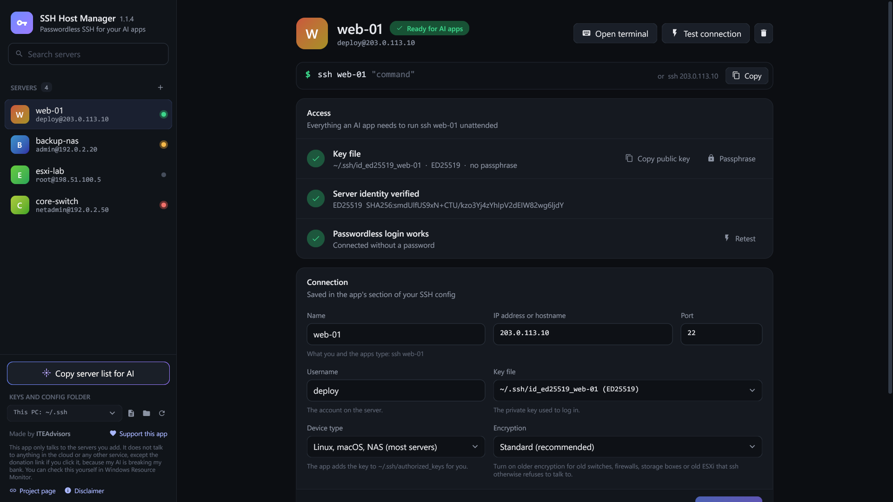

# SSH Host Manager

**How do I set up passwordless SSH for AI agents (Claude Code, Codex, etc.) on Windows?**

SSH Host Manager is a small native Windows app that does exactly that. It creates a dedicated key for each server, installs it after you type the password once, and writes a standard OpenSSH `Host` entry so you (or any AI app that can run `ssh`) can do:

```
ssh <name> "<command>"
```

or even just `ssh 203.0.113.10 "<command>"`.

No passwords, no prompts, no extra tools.

> **This app only talks to the servers you add.** It does not talk to anything in the cloud or any other service. You can check this yourself in Windows Resource Monitor (see [How you can check the privacy claim](#how-you-can-check-the-privacy-claim)). The one exception is the donation link, which opens in your browser if you click it.

Made by ITEAdvisors. Free to use. The source code is private and the app may not be copied or redistributed (see [License](#license)). [Donate](https://donate.stripe.com/eVq6oz0LU7ucgX19KE57W00) if it helps you.



**[Read the manual](MANUAL.md)** · **[Privacy policy](PRIVACY.md)**

## Download
**[Download SSHHostManager.exe](https://github.com/ITEAdvisors/ssh-host-manager/releases/latest/download/SSHHostManager.exe)** for Windows 10 and 11. There is no installer. All versions are on the [Releases](https://github.com/ITEAdvisors/ssh-host-manager/releases) page.

The file is not code-signed yet, so Windows shows "Windows protected your PC" the first time: click **More info**, then **Run anyway**. To check that your copy is the published one, compare the result of `Get-FileHash .\SSHHostManager.exe` with the SHA-256 in the release notes.

## Why this exists
Windows OpenSSH does not include `ssh-copy-id`. Setting up passwordless SSH by hand means generating a key, copying the public key with a PowerShell one-liner, fixing permissions, and editing `~/.ssh/config`. That is fine once, annoying every time, and easy to get wrong when you want a clean key per server for AI agents.

This app does the whole flow in one window:
- Create a dedicated key for the server
- Install the public key (you type the password once)
- Verify the host fingerprint
- Write the OpenSSH config entry
- Optionally open a terminal to test

Everything stays in standard OpenSSH files. AI agents just run normal `ssh` commands.

## What it does
- Creates a dedicated key for each server and installs it after you type the password once.
- Works with Linux, macOS, NAS, VMware ESXi, Windows OpenSSH Server, and network devices.
- Verifies each server's fingerprint before trusting it, and lets you remove host keys one at a time.
- Opens a terminal logged in to a server with one click, for your own use.
- Lets you put a passphrase on a key and lock or unlock it, with the state shown as soon as the app opens. The passphrase is typed into ssh's own window; the app never sees or stores it.
- Keeps everything in standard OpenSSH files (`config`, `known_hosts`, key files), in `~/.ssh`, OneDrive, or a folder you pick.
- Can allow older encryption for one legacy device without weakening the others.

## FAQ

**How do I set up passwordless SSH for Claude Code or Codex on Windows?**  
Download the app, add the server, type the password once. After that, any tool that can run `ssh <name> "command"` works without prompts.

**Is this open source?**  
No. The app is free to use, but the source code is private. You may not copy, modify or redistribute the app. See the [License](#license).

**Does the app talk to the cloud?**  
No. The only network activity is the SSH connections you create, plus one plain TCP connection to the server's address and port to check that it can be reached before its host key is read. The donation link and the project page link open in your browser only if you click them.

**Is it safe to give AI agents passwordless SSH?**  
The keys have no passphrase by default so unattended tools can use them. Anyone (or any AI) running under your Windows account can then run any command on the servers you add. Only add systems you own or are allowed to manage. The app shows this warning on first launch.

**Can I use my existing keys?**  
Yes. By default the app creates a new key for each server, but you can pick an existing key file in the **Key file** list instead. It writes only its marked block in `config`; your other keys and config entries are left alone.

**Why not just use the PowerShell one-liner?**  
You can. This exists for people who want the one-page GUI version that also handles fingerprints, known_hosts cleanup, per-server keys, and config hygiene.

## How you can check the privacy claim
- The window is drawn by the app itself. There is no browser, web view or embedded web page.
- Watch it yourself: open Resource Monitor, go to the Network tab, and tick `SSHHostManager.exe` and `ssh.exe`. You will only see the servers you added.
- The app works through the `ssh`, `ssh-keygen`, `ssh-keyscan` and `ssh-add` programs that come with Windows, and writes only standard OpenSSH files that you can open in any text editor.
- The [privacy policy](PRIVACY.md) lists everything the app stores and everything that leaves your computer.

Two things happen outside the app. If you enter a hostname instead of an IP address, Windows looks the name up through your usual DNS server, as it does for any program. If you choose the OneDrive folder, OneDrive, not this app, syncs the files.

## What it manages
- `config`: only the block between the `# >>> SSH Server Manager` markers is rewritten. Everything else is kept as-is, and `config.bak` is saved before each write. Each server is written as `Host <name> <address>`, so both forms use the key.
- `known_hosts`: host keys are shown, verified by fingerprint before trusting, replaced when a server changes, and cleaned up when a server is deleted or moved.
- Per-server keys (`id_ed25519_<name>` or `id_rsa_<name>`), with no passphrase by default so apps can use them unattended. A key can be given a passphrase; it is then unlocked through Windows' own ssh-agent, which holds the unlocked key. The app keeps only the list of key files to lock again when it closes.

When the app works in a folder other than `%USERPROFILE%\.ssh`, it adds a small `# >>> SSH Server Manager: app folder` block with an `Include` line at the top of `%USERPROFILE%\.ssh\config`, names the folder's `known_hosts` per server, and restricts the permissions of the config and keys it writes there (ssh refuses them otherwise). The folder choice is remembered in `%LOCALAPPDATA%\SSHHostManager\settings.json`.

Runtime requirements: Windows 10 or 11 with the OpenSSH Client (built in).

## License
The app is free to use, but it is not open source. In short:

- You may use the app free of charge, personally or inside your organization.
- You may not modify it, copy it into other software, or redistribute it. Sharing a link to this page is fine.

The exact terms are in [LICENSE](LICENSE). For anything it does not allow, ask ITEAdvisors first.

The app is built with open-source libraries. Their licenses are in [THIRD-PARTY-NOTICES.txt](THIRD-PARTY-NOTICES.txt).

## Disclaimer
- **No warranty.** The app is provided as is, with no warranty of any kind. The author is not liable for any damage or loss from using it.
- **You are responsible for what you allow.** The keys have no passphrase so that AI apps can log in without asking. Anyone, and any AI app, using your Windows account can then run any command on the servers you add, including destructive ones.
- **Authorized systems only.** Only add servers and devices that you own or are allowed to manage.
- **Older encryption is weaker.** Allowing it for a device lowers the security of the connection to that device. Use it only where the device offers nothing better.
- **Donations are voluntary.** A donation is a gift, not a purchase, and comes with no support or service obligation.
- **Not affiliated.** This app is not affiliated with or endorsed by Anthropic, OpenAI, Microsoft, VMware or any other company named here. Their names are trademarks of their owners.

The app shows the first three points when it is first started and asks you to accept them. You can read them again from **Disclaimer** at the bottom left of the window.
